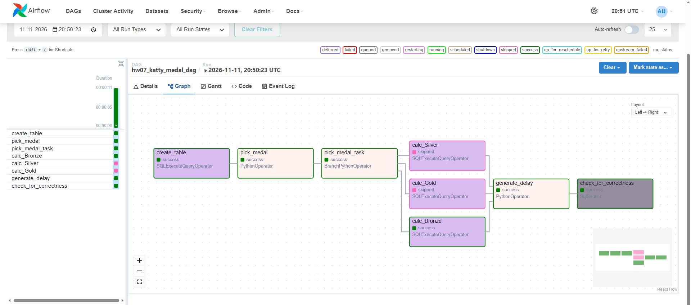
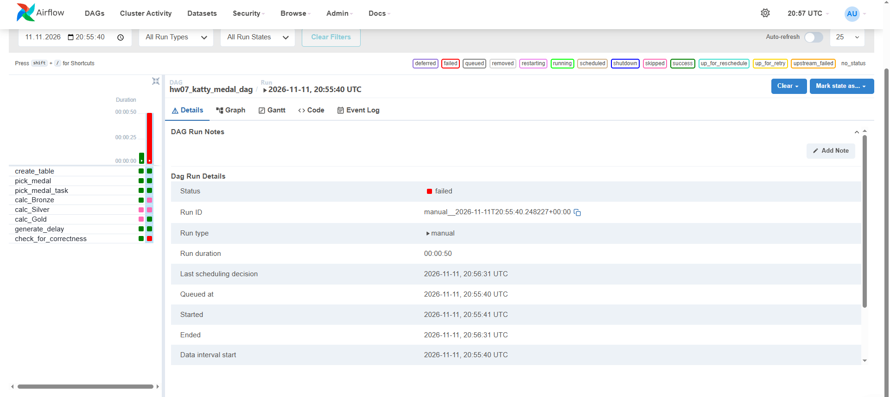
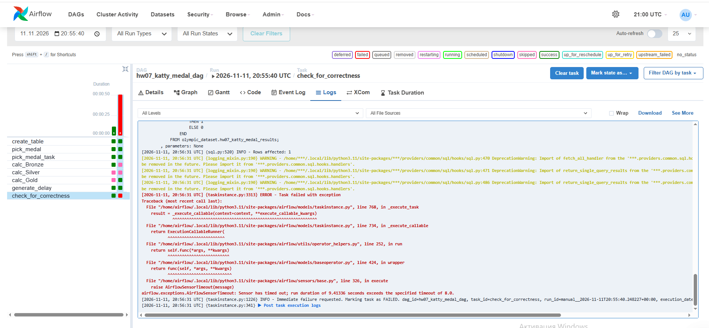
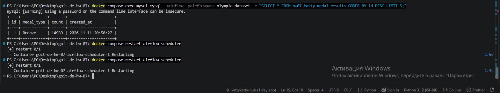

# GoIT Data Engineering — HW-07: Apache Airflow and MySQL

A reproducible local Apache Airflow pipeline that randomly selects an Olympic medal type, counts matching records in MySQL, stores the result, and verifies that the newly inserted record is recent enough. The project demonstrates branching, SQL operators, trigger rules, and a SQL sensor, including both successful and intentionally failed DAG runs.

## Technology stack

- **Apache Airflow 2.10.5** — DAG scheduling and task orchestration
- **Python 3.11** — random medal selection, branching, and simulated processing delay
- **MySQL 8.0** — Olympic source data and calculated results
- **PostgreSQL 15** — Airflow metadata database
- **Docker Desktop / Docker Compose** — local development environment

## DAG workflow

**DAG ID:** `hw07_katty_medal_dag`  
**DAG file:** `dags/hw07_medal_dag.py`  
**Airflow connection ID:** `goit_mysql_db_katty`  
**Schedule:** manual (`schedule=None`)

```text
create_table
    |
pick_medal
    |
pick_medal_task
    |-----------------------|----------------------|
calc_Bronze            calc_Silver            calc_Gold
    |-----------------------|----------------------|
                       |
                 generate_delay
                       |
              check_for_correctness
```

| Task | Operator | Purpose |
| --- | --- | --- |
| `create_table` | `SQLExecuteQueryOperator` | Creates the MySQL results table if it does not exist. |
| `pick_medal` | `PythonOperator` | Randomly chooses `Bronze`, `Silver`, or `Gold`. |
| `pick_medal_task` | `BranchPythonOperator` | Selects the corresponding medal-count task. |
| `calc_Bronze` / `calc_Silver` / `calc_Gold` | `SQLExecuteQueryOperator` | Counts rows with the selected medal and inserts a result into MySQL. |
| `generate_delay` | `PythonOperator` | Waits for the configured number of seconds; uses `NONE_FAILED_MIN_ONE_SUCCESS` so skipped branches do not block execution. |
| `check_for_correctness` | `SqlSensor` | Checks whether the latest inserted result is no more than 30 seconds old. |

The two branches that are not selected are marked **skipped**, which is expected behavior, not a task failure.

## Dataset and database

Place the Olympic dataset at:

```text
data/athlete_event_results.csv
```

The CSV must contain the columns:

```text
edition,edition_id,country_noc,sport,event,result_id,athlete,athlete_id,pos,medal,isTeamSport
```

The local MySQL initialization script (`mysql-init/01-init.sql`) imports the CSV into `olympic_dataset.athlete_event_results`. The DAG writes to `olympic_dataset.hw07_katty_medal_results` with columns `id`, `medal_type`, `count`, and `created_at`.

The dataset was successfully imported with **316,834 records**. The observed medal counts were:

| Medal | Records |
| --- | ---: |
| Gold | 15,072 |
| Silver | 14,676 |
| Bronze | 14,939 |

## Run locally with Docker

### Prerequisites

- Docker Desktop with Linux containers enabled
- Docker Compose
- `athlete_event_results.csv` placed in the `data/` directory

### 1. Start the services

From the project root:

```powershell
docker compose config --quiet
docker compose up -d --build
```

The Compose configuration starts PostgreSQL, MySQL, an Airflow initialization job, the Airflow webserver, and the scheduler. The MySQL initialization script runs when the MySQL data volume is first created.

### 2. Verify the services

```powershell
docker compose ps -a
```

Expected: PostgreSQL and MySQL healthy, Airflow webserver and scheduler running, and `airflow-init` exited with code `0`.

### 3. Open Airflow

Visit **http://localhost:8080** and sign in with the development-only credentials configured in `docker-compose.yaml` (default: `admin` / `admin`). Do not reuse these credentials in production.

Find `hw07_katty_medal_dag`, unpause it, and trigger a manual run. Alternatively:

```powershell
docker compose exec airflow-scheduler airflow dags list-import-errors
docker compose exec airflow-scheduler airflow dags unpause hw07_katty_medal_dag
```

### 4. Inspect the MySQL results

```powershell
docker compose exec mysql mysql -uairflow -pairflowpass olympic_dataset -e "SELECT * FROM hw07_katty_medal_results ORDER BY id DESC LIMIT 5;"
```

The command-line password warning is expected in this local example. For real deployments, use a secrets manager or other protected credential mechanism.

## Testing and results

The sensor checks the age of the most recent record using MySQL time functions. The freshness threshold is **30 seconds**. The sensor's own timeout is **8 seconds** (`poke_interval=2`, `mode="reschedule"`). These are separate settings.

### Test 1 — Successful run (5-second delay)

Set `DELAY_SECONDS = 5` in `dags/hw07_medal_dag.py` and trigger the DAG.

**Observed result:** DAG succeeded. The randomly selected branch was `calc_Bronze`; `calc_Silver` and `calc_Gold` were skipped. The sensor succeeded and MySQL stored the Bronze count of **14,939**.



### Test 2 — Expected sensor failure (35-second delay)

Temporarily set `DELAY_SECONDS = 35`, save the DAG, allow the scheduler to reload it, and trigger another run.

**Observed result:** DAG failed after approximately **50 seconds**. The selected medal-count task and delay task succeeded, but `check_for_correctness` failed because the newly inserted record no longer satisfied the 30-second freshness check. The sensor raised `AirflowSensorTimeout` after approximately **9.41 seconds**, exceeding its configured 8-second timeout.



**Sensor failure log:**



### MySQL verification

The SQL query returned the inserted Bronze record (`id = 1`, `count = 14939`, `created_at = 2026-11-11 20:50:27`).



After testing the failure scenario, restore `DELAY_SECONDS = 5` as the default configuration.

## Project structure

```text
goit-de-hw-07/
├── dags/
│   └── hw07_medal_dag.py
├── data/
│   └── athlete_event_results.csv  # local dataset; not committed
├── mysql-init/
│   └── 01-init.sql
├── screenshots/
│   ├── dag_success.png
│   ├── dag_failed.png
│   ├── sensor_timeout.png
│   └── mysql_results.png
├── Dockerfile
├── docker-compose.yaml
├── .gitignore
└── README.md
```

The runtime directories `logs/` and `plugins/` may also exist locally. Docker volumes persist MySQL and PostgreSQL data across normal container restarts.

## Notes

- This is a **local educational setup**, not a production deployment.
- The CSV is not included in this repository; obtain the course dataset and place it in `data/` before starting the containers.
- MySQL initialization scripts execute only for a **new, empty** MySQL data volume. Avoid `docker compose down -v` unless you explicitly want to delete the local databases.
- If you change the DAG code, allow the scheduler time to reload it; `docker compose restart airflow-scheduler` can help during local testing.
- Airflow metadata and the Olympic dataset are stored in **different databases**: PostgreSQL and MySQL, respectively.

## Conclusion

The assignment demonstrates a functioning Airflow DAG with conditional branching, SQL-based aggregation, MySQL result persistence, and freshness validation. Both the successful 5-second scenario and the intentionally failed 35-second scenario were executed and documented with screenshots and a sensor timeout log.
